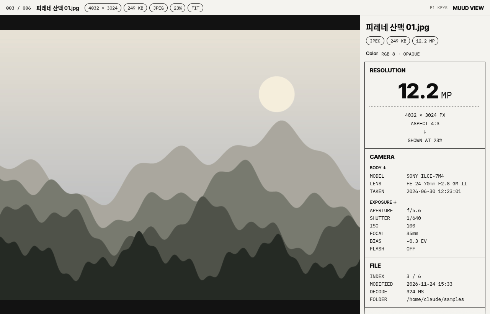
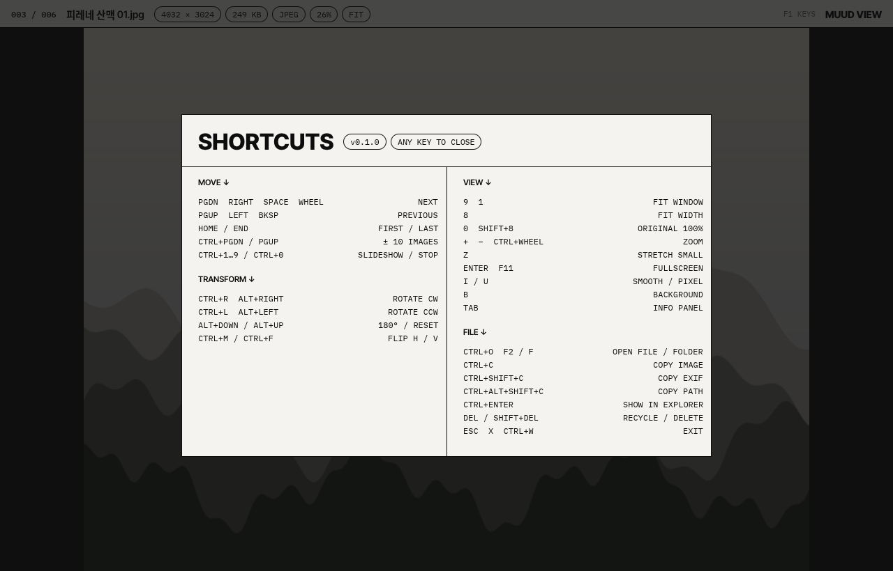

# MUUD VIEW

광고 없고, 빠르고, 조용한 Windows용 이미지 뷰어. Rust로 만들었습니다.

`v0.1` · `Windows 10/11 x64` · `NO ADS` · `OFFLINE` · `MIT`


| 정보 패널 (`Tab`) | 단축키 (`F1`) |
|---|---|
|  |  |

## 특징

- **즉시 넘김** — 현재 이미지의 앞뒤 파일을 백그라운드 스레드에서 미리 디코딩하고 GPU에 올려 둡니다.
- **익숙한 단축키** — 국내 이미지 뷰어에서 쓰던 키 그대로: `PgDn`/`Space` 다음, `Enter` 전체화면, `Tab` 정보, `Ctrl+R` 회전 …
- **설치 없음** — `muud-view.exe` 하나. C 런타임까지 정적으로 넣어 VC++ 재배포 패키지도 필요 없습니다.
- **네트워크 0** — 통신 코드가 아예 없습니다. 광고·업데이트 확인·텔레메트리 없음.
- **스펙 시트 디자인** — 흑백, 굵은 그로테스크 제목, 고정폭 데이터, 헤어라인과 점선.

지원 포맷: JPEG · PNG · GIF(애니메이션) · WebP(애니메이션) · BMP · TIFF · TGA · ICO · PNM · QOI · DDS · HDR · EXR

## 설치

1. [Releases](https://github.com/recall2300/muud-view/releases)에서 `muud-view-vX.Y.Z-windows-x64.zip`을 받아 원하는 폴더에 풉니다.
2. `muud-view.exe`를 실행하거나, 이미지를 창에 끌어다 놓습니다.
3. 기본 뷰어로 쓰려면: 이미지 파일 우클릭 → **연결 프로그램** → **다른 앱 선택** → `muud-view.exe` → **항상 사용**.

### "Windows의 PC 보호" 경고가 뜨면

코드 서명 인증서가 없는 실행 파일이라 SmartScreen이 경고합니다.

- **추가 정보 → 실행**을 누르거나,
- 실행 전에 `muud-view.exe` 우클릭 → **속성** → 하단 **차단 해제** 체크 → 확인.

회사 PC에서 EDR/백신 정책으로 실행 자체가 막히면 IT 담당자에게 아래 검증 정보를 전달해 승인을 요청하세요.

### 파일 검증 (IT 승인용)

모든 릴리스 파일은 GitHub Actions가 이 저장소의 공개 소스로 빌드합니다. 사람이 만든 바이너리를 올리지 않습니다.

```powershell
# 1) 해시 확인 — 릴리스의 SHA256SUMS.txt 값과 같아야 합니다
Get-FileHash .\muud-view-v0.1.0-windows-x64.zip -Algorithm SHA256

# 2) 빌드 출처 증명 확인 — 어느 커밋에서 어떤 워크플로로 빌드됐는지 검증
gh attestation verify .\muud-view-v0.1.0-windows-x64.zip --repo recall2300/muud-view
```

## 단축키

| | |
|---|---|
| 다음 / 이전 | `PgDn` `→` `Space` 휠 / `PgUp` `←` `Backspace` |
| 처음 / 끝, ±10장 | `Home` / `End`, `Ctrl+PgDn` / `Ctrl+PgUp` |
| 창 맞춤 / 폭 맞춤 / 100% | `9` `1` / `8` / `0` |
| 확대 / 축소 | `+` `-` `Ctrl+휠` (커서 위치 기준) |
| 전체화면 / 최대화 | `Enter` `F11` 가운데 클릭 / `M` 더블클릭 |
| 회전 / 뒤집기 | `Ctrl+R` `Ctrl+L` `Alt+방향키` / `Ctrl+M` `Ctrl+F` |
| 정보 패널 | `Tab` |
| 복사: 이미지 / EXIF / 경로 | `Ctrl+C` / `Ctrl+Shift+C` / `Ctrl+Alt+Shift+C` |
| 휴지통 / 완전 삭제 | `Delete` / `Shift+Delete` (확인 후) |
| 슬라이드쇼 | `Ctrl+1`…`Ctrl+9` 초 간격, `Ctrl+0` 정지 |
| 배경 (검정·종이·회색) | `B` |
| 열기 | `Ctrl+O` `F2` 파일, `F` 폴더 |
| 종료 | `Esc` `X` `Ctrl+W` |

전체 목록과 이후 계획은 [docs/SPEC.md](docs/SPEC.md)에 있습니다.

## 라이선스

- muud view: [MIT](LICENSE)
- 포함 폰트: Inter Tight, IBM Plex Mono — SIL Open Font License 1.1 (`assets/fonts/OFL-*.txt`)
- 한글은 Windows의 맑은 고딕을 실행 시 읽어 씁니다(파일을 포함하지 않음).
- 사용한 Rust 라이브러리는 모두 MIT/Apache-2.0/BSD 계열 허용 라이선스입니다. CI의 `cargo deny`가 GPL/LGPL 같은 카피레프트 라이선스가 섞이면 빌드를 실패시킵니다. 각 릴리스에는 전체 고지문 `THIRD_PARTY_NOTICES.html`이 들어 있습니다.

muud view는 처음부터 새로 작성했습니다. 기능과 단축키는 공개 문서와 일반적인 뷰어 사용 관례만 참고했고, 다른 뷰어의 바이너리·코드·리소스는 분석하거나 사용하지 않았습니다.

## 개발

```bash
cargo run -- path/to/image.jpg   # 실행
cargo test                       # 테스트
cargo deny check licenses        # 라이선스 정책 확인
```

릴리스: `Cargo.toml`의 `version`을 올리고 커밋한 뒤 태그를 push하면 GitHub Actions가 빌드·패키징·게시합니다.

```bash
git tag v0.1.0
git push origin v0.1.0
```

`main`에 push할 때마다 CI가 Windows에서 빌드·테스트하고, 결과 `muud-view.exe`를 Actions 아티팩트로 14일간 보관합니다.
