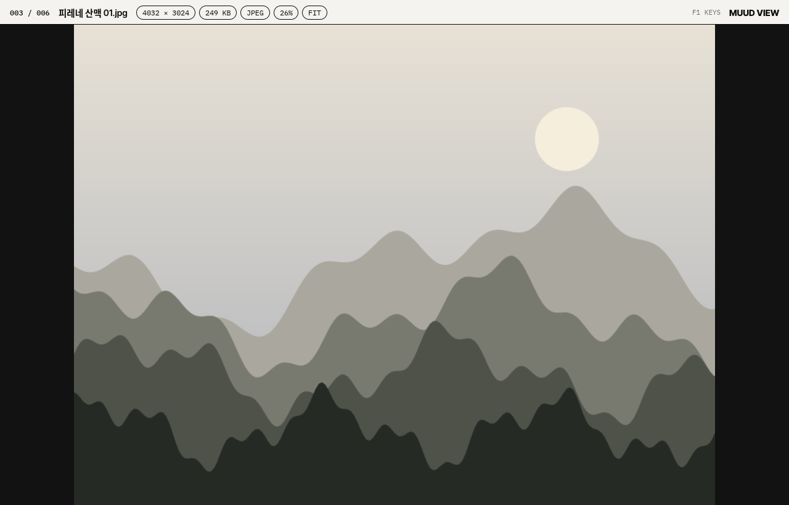

# MUUD VIEW

광고 없고, 빠르고, 조용한 Windows용 이미지 뷰어. Rust로 만들었습니다.

`v0.1` · `Windows 10/11 x64` · `NO ADS` · `OFFLINE` · `MIT`



| 정보 패널 (`Tab`) | 단축키 (`F1`) |
|---|---|
|  |  |

## 특징

- **즉시 넘김** — 다음 10장을 미리 읽어 두고(NAS도 기다리지 않게), 코어 수만큼의 스레드가 앞뒤 사진을 화면 크기로 미리 디코딩해 GPU에 올려 둡니다. 키를 누르고 있으면 중간 사진은 건너뜁니다.
- **원본 화질** — 확대하면 원본 해상도로 바꾸고, GPU 한도(16,384px)를 넘는 이미지도 타일로 나눠 100%에서 그대로 보여줍니다.
- **정확한 색** — 사진에 들어 있는 ICC 프로파일(Display P3, Adobe RGB …)을 sRGB로 변환합니다.
- **폴더 변경 반영** — 보는 중에 다른 프로그램이 파일을 추가·삭제·이름 변경하면 목록에 바로 반영합니다.
- **익숙한 단축키** — 국내 이미지 뷰어에서 쓰던 키 그대로: `PgDn`/`Space` 다음, `Enter` 전체화면, `Tab` 정보, `Ctrl+R` 회전 …
- **설치 없음** — `muud-view.exe` 하나. C 런타임까지 정적으로 넣어 VC++ 재배포 패키지도 필요 없습니다.
- **네트워크 0** — 통신 코드가 아예 없습니다. 광고·업데이트 확인·텔레메트리 없음.
- **스펙 시트 디자인** — 흑백, 굵은 그로테스크 제목, 고정폭 데이터, 헤어라인과 점선.

지원 포맷: JPEG · PNG · GIF(애니메이션) · WebP(애니메이션) · BMP · TIFF · TGA · ICO · PNM · QOI · DDS · HDR · EXR

## 설치

1. [Releases](https://github.com/recall2300/muud-view/releases)에서 `muud-view-vX.Y.Z-windows-x64.zip`을 받아 원하는 폴더에 풉니다.
2. `muud-view.exe`를 실행하거나, 이미지를 창에 끌어다 놓습니다.
3. 기본 뷰어로 쓰려면: muud view에서 `F5` → `1 SET AS IMAGE VIEWER` → 열리는 Windows 기본 앱 화면에서 muud view 선택.
   우클릭 메뉴("muud view로 열기", "muud view로 폴더 보기")도 함께 등록되고, `F5` → `3`으로 모두 지울 수 있습니다.
   관리자 권한은 필요 없습니다. 스크립트로는 `muud-view.exe --register` / `--unregister`.
4. 창이 열려 있을 때 다른 사진을 열면 새 창 대신 기존 창에서 열립니다.
5. USB나 공용 PC에서 쓰려면 exe 옆에 `portable`이라는 빈 파일을 만드세요. 설정과 로그가 exe 옆 `muud-view-data` 폴더에 저장됩니다.

### "Windows의 PC 보호" 경고가 뜨면

코드 서명 인증서가 없는 실행 파일이라 SmartScreen이 경고합니다.

- **추가 정보 → 실행**을 누르거나,
- 실행 전에 `muud-view.exe` 우클릭 → **속성** → 하단 **차단 해제** 체크 → 확인.

회사 PC에서 EDR/백신 정책으로 실행 자체가 막히면 IT 담당자에게 아래 검증 정보를 전달해 승인을 요청하세요.

### 파일 검증 (IT 승인용)

모든 릴리스 파일은 GitHub Actions가 이 저장소의 공개 소스로 빌드합니다. 사람이 만든 바이너리를 올리지 않습니다.

```powershell
# 1) 해시 확인 — 릴리스의 SHA256SUMS.txt 값과 같아야 합니다
Get-FileHash .\muud-view-v0.1.0-windows-x64.zip -Algorithm SHA256

# 2) 빌드 출처 증명 확인 — 어느 커밋에서 어떤 워크플로로 빌드됐는지 검증
gh attestation verify .\muud-view-v0.1.0-windows-x64.zip --repo recall2300/muud-view
```

## 단축키

모든 키는 `F5` → 단축키 탭에서 바꿀 수 있고, `keymap.txt`로 내보내 팀원과 공유할 수 있습니다. 아래는 기본값입니다.

| | |
|---|---|
| 다음 / 이전 | `PgDn` `→` `Space` 휠 / `PgUp` `←` `Backspace` |
| 처음 / 끝, ±10장 | `Home` / `End`, `Ctrl+PgDn` / `Ctrl+PgUp` |
| 창 맞춤 / 폭 맞춤 / 100% | `9` `1` / `8` / `0` |
| 확대 / 축소 | `+` `-` `Ctrl+휠` (커서 위치 기준) |
| 전체화면 / 최대화 | `Enter` `F11` 가운데 클릭 / `M` 더블클릭 |
| 회전 / 뒤집기 | `Ctrl+R` `Ctrl+L` `Alt+방향키` / `Ctrl+M` `Ctrl+F` |
| 정보 패널 / 미니맵 (확대 시) | `Tab` / `/` |
| 복사: 이미지+파일 / 작게 / EXIF / 경로 | `Ctrl+C` / `Ctrl+Alt+C` / `Ctrl+Shift+C` / `Ctrl+Alt+Shift+C` |
| 클립보드 이미지 보기 | `Ctrl+V` |
| 휴지통 / 완전 삭제 | `Delete` / `Shift+Delete` (확인 후) |
| 사진보관함 | `Insert` 1번에 복사, `Ctrl+Insert` 1번으로 이동, `Shift+Insert` 2번에 복사, `Alt+1~9` |
| 되돌리기 (이동·삭제·복사) | `Ctrl+Z` |
| 슬라이드쇼 | `Ctrl+1`…`Ctrl+9` 초 간격, `Ctrl+0` 정지 |
| 배경 (검정·종이·회색) | `B` |
| 상단 / 하단 바 고정 | `` ` `` / `~` (해제하면 마우스를 가까이 가져갈 때만 표시) |
| 열기 | `Ctrl+O` `F2` 파일, `F` 폴더 |
| 설정 (일반·보기·마우스·단축키·보관함·Windows) | `F5` |
| 최근·즐겨찾기 폴더 | `F3` `Ctrl+B` (`S` 즐겨찾기) |
| 배율 고정 / 화면 표시 | `Ctrl+K` / `O` |
| 무작위 | `Ctrl+Alt+PgDn` |
| 이름 바꾸기 | `Shift+F2` |
| 종료 | `Esc` `X` `Ctrl+W` |

전체 목록은 [docs/SPEC.md](docs/SPEC.md), 계획은 [docs/ROADMAP.md](docs/ROADMAP.md) · [docs/PLAN.md](docs/PLAN.md), 진행 기록은 [docs/PROGRESS.md](docs/PROGRESS.md), 성능 측정은 [docs/BENCHMARKS.md](docs/BENCHMARKS.md)에 있습니다.

문제가 생기면 `F5` → `4 COPY DIAGNOSTICS`로 진단 정보를 복사해 [이슈](https://github.com/recall2300/muud-view/issues/new?template=bug_report.md)에 붙여 주세요.

## 라이선스

- muud view: [MIT](LICENSE)
- 포함 폰트: Inter Tight, IBM Plex Mono — SIL Open Font License 1.1 (`assets/fonts/OFL-*.txt`)
- 한글은 Windows의 맑은 고딕을 실행 시 읽어 씁니다(파일을 포함하지 않음).
- 사용한 Rust 라이브러리는 모두 MIT/Apache-2.0/BSD 계열 허용 라이선스입니다. CI의 `cargo deny`가 GPL/LGPL 같은 카피레프트 라이선스가 섞이면 빌드를 실패시킵니다. 각 릴리스에는 전체 고지문 `THIRD_PARTY_NOTICES.html`이 들어 있습니다.

muud view는 처음부터 새로 작성했습니다. 기능과 단축키는 공개 문서와 일반적인 뷰어 사용 관례만 참고했고, 다른 뷰어의 바이너리·코드·리소스는 분석하거나 사용하지 않았습니다.

## 개발

```bash
cargo run -- path/to/image.jpg   # 실행
cargo test                       # 테스트
cargo deny check licenses        # 라이선스 정책 확인
```

릴리스는 두 가지 방법 중 하나로 만듭니다. GitHub Actions가 빌드·패키징·게시까지 합니다.

- GitHub 웹(폰 포함): **Actions → Release → Run workflow** → 버전(`v0.1.0` 형식) 입력 → Run
- 터미널: `git tag v0.1.0 && git push origin v0.1.0`

버전을 올릴 때는 `Cargo.toml`의 `version`도 같이 올려 주세요.

`main`에 push할 때마다 CI가 Windows에서 빌드·테스트하고, 결과 `muud-view.exe`를 Actions 아티팩트로 14일간 보관합니다.
